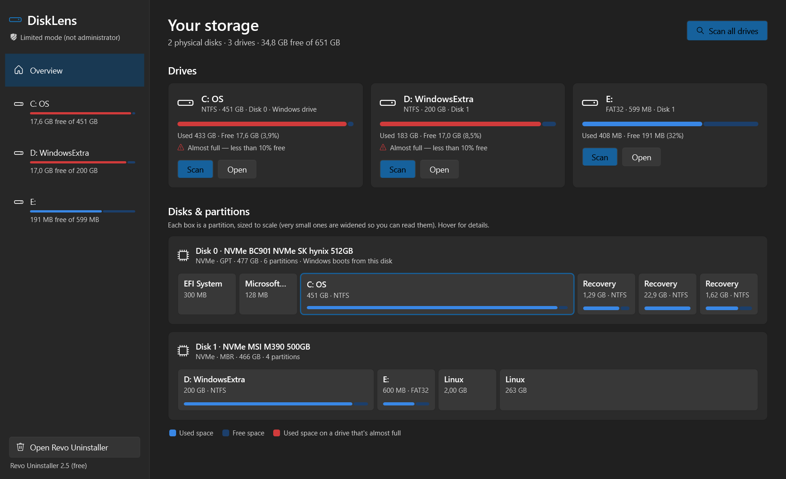

# DiskLens

**A disk-space analyzer for Windows that answers one question per drive: what is eating my storage?**

DiskLens runs as administrator, reads every folder on a drive, and gives you straight answers instead of a
wall of numbers: the heaviest **file**, **folder**, **app** and **system item** on each drive. It shows
what each item is and what you can do about it.



## Features

- **Disks & partitions.** Every physical disk is drawn as a bar split into its partitions: EFI, Recovery,
  Microsoft Reserved, Linux, unallocated space and your drives, each with its size and file system.
- **Quick answers.** After a scan, four cards answer the questions that matter:
  - *Heaviest file*, such as a forgotten VM disk or an old installer
  - *Heaviest folder*, which looks inside Users, Program Files and game libraries instead of stopping at the top
  - *Heaviest app*, measured from its real folder and not just what the installer claims
  - *Biggest system item*, such as the page file, hibernation file, WinSxS or restore points
- **Where your space goes.** One bar splits the drive into System · Apps & app data · Your files · Other ·
  Hidden from the scan · Free, so the numbers always add up to what Windows reports.
- **Largest files.** The 500 biggest files on the drive, filterable by type (videos, disk images, game data,
  archives, installers…).
- **Folders.** Drill down folder by folder with breadcrumbs. Each item shows its share of the folder it's in.
- **Apps.** Installed programs (and Microsoft Store apps) sorted by the space they really use, on whichever
  drive they live. Apps nested inside another app's folder are counted once.
- **System.** Each heavy system item gets a plain-English explanation, a safe tip and a button that opens
  the right Windows tool (Disk Cleanup, Storage settings, System Protection…).
- **Revo Uninstaller hand-off.** "Uninstall with Revo" opens [Revo Uninstaller](https://www.revouninstaller.com/)
  and copies the app's name, ready to paste into Revo's search box. Revo then removes the app and its
  leftovers. Works with the free and Pro versions. If Revo isn't installed, Windows' *Installed apps* page
  opens instead.
- **Move to Recycle Bin.** Remove files and folders you no longer need, always after a confirmation.
  Everything can be restored from the Recycle Bin.
- Follows Windows light/dark mode (Fluent design).

## Safety

DiskLens only reads your drives until you ask it to move something to the Recycle Bin. It never deletes
anything permanently and never runs cleanup commands itself.

"Move to Recycle Bin" is refused, with the reason shown, for:

- the Windows folder, drive roots, `pagefile.sys`, `hiberfil.sys`, `swapfile.sys`
- `System Volume Information`, `$Recycle.Bin`, `Recovery`, `Boot`, `EFI`, `Windows.old` (use Disk Cleanup)
- `Program Files`, the `ProgramData` root and `ProgramData\Microsoft`
- `Users`, each user profile, `AppData` roots and your main folders (Documents, Downloads…) themselves
- installed apps' folders, and folders that contain them: uninstall those with Revo instead
- drives without a Recycle Bin (FAT32 / removable), where deleting would be permanent

### Privacy & security

- **No internet.** DiskLens has no network code at all: no updates, no telemetry, no accounts. Nothing
  about your files leaves your PC.
- **It doesn't open your files.** It reads names and sizes, never file contents, so a booby-trapped file
  can't attack it the way a malicious video or document can attack a player or viewer.
- **It only starts programs from Windows or Program Files**, by full path. Revo Uninstaller is only used
  from Program Files, and Windows tools only from the Windows folder. Since DiskLens runs as
  administrator, other software can't plant a look-alike program for it to launch.
- **Open source (MIT).** Every line is here to read, and you can build the exe yourself.
- The release exe isn't code-signed, so Windows SmartScreen may warn the first time you run it. Each
  release lists the file's SHA-256 so you can check it (`Get-FileHash DiskLens.exe` in PowerShell).
- Keep `DiskLens.exe` in a folder of its own (for example `C:\Program Files\DiskLens`) rather than running
  it straight from Downloads. This is good practice for any program that runs as administrator.

## Requirements

- Windows 10 or 11 (64-bit)
- [.NET 9 Desktop Runtime](https://dotnet.microsoft.com/download/dotnet/9.0)
- Optional: [Revo Uninstaller](https://www.revouninstaller.com/) (free or Pro)

## Getting started

1. Download `DiskLens.exe` from the [Releases](../../releases) page.
2. Run it and accept the Windows administrator prompt. Administrator rights let DiskLens read protected
   folders and measure System Restore points. If you decline, it runs in *limited mode* and shows what it
   can read.
3. Pick a drive and press **Scan**.

## How sizes are measured

- Folders are read in parallel. Junctions and symbolic links are not followed, so nothing is counted twice.
- OneDrive files that are only in the cloud count as 0 bytes, because they take no space on the disk.
- Some space can't be listed by any app, not even as administrator: restore points, the file-system's
  own data and locked folders. It is shown as *Hidden from the scan*, worked out as space Windows reports
  as used minus what the scan found.
- WinSxS looks bigger than it is: many of its files are hard links to files in System32.
- App sizes come from the app's folder in the scan. When the installer didn't record a folder, its own
  estimate is shown, marked with `≈`.

## Build from source

Requires the [.NET 9 SDK](https://dotnet.microsoft.com/download/dotnet/9.0).

```bash
dotnet build
dotnet test
```

Single-file release build (`publish\DiskLens.exe`):

```bash
dotnet publish src/DiskLens/DiskLens.csproj -c Release -r win-x64 --self-contained false -p:PublishSingleFile=true -o publish
```

### Development tips

- `-p:DevNoElevation=true` builds without the administrator manifest, so the app starts without a UAC
  prompt while you work on it.
- The app can render itself to a PNG for quick visual checks:

  ```bash
  DiskLens.exe --snapshot out.png --page D --scan --tab 1 --theme light --width 1400 --height 1000
  ```

  `--page` picks a drive letter, `--scan` scans it first, `--tab` opens a tab (0 Largest files,
  1 Folders, 2 Apps, 3 System), and `--folder` opens a folder in the Folders tab.

### Project layout

```
src/DiskLens.Core    disk & partition info (WMI), scanner, categories, installed apps,
                     system items, Recycle Bin rules — no UI
src/DiskLens         WPF app (MVVM): views, view models, theme
tests/DiskLens.Tests xUnit tests
```

## License

[MIT](LICENSE)

Revo Uninstaller is a product of VS Revo Group. DiskLens is not affiliated with it; it only opens it.
